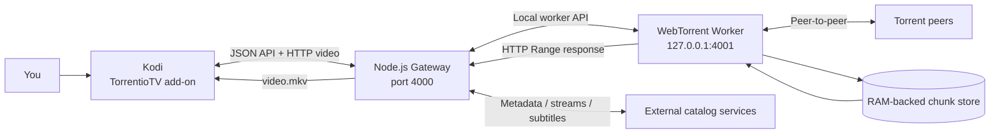
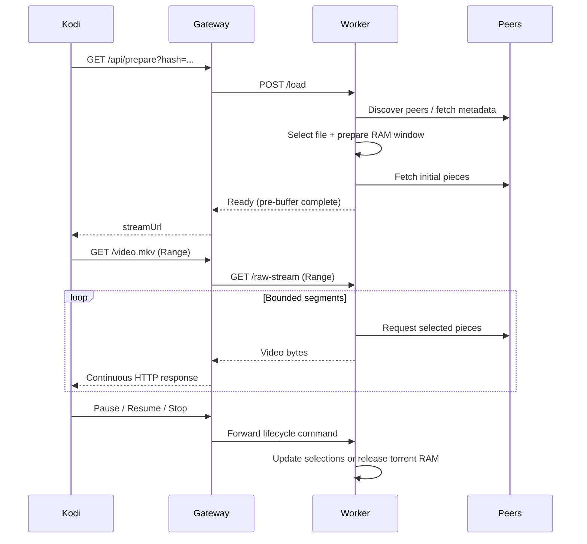

# TorrentioTV

<p align="center">
  <strong>A RAM-first, peer-to-peer streaming bridge for Kodi.</strong>
  <br />
  Discover a title. Find a torrent. Pre-buffer in memory. Let Kodi play.
</p>

<p align="center">
  
  
  
  
  
</p>

TorrentioTV connects a Kodi video add-on to a Node.js gateway and a WebTorrent worker. Its central idea is simple: **keep the active torrent data in memory, maintain a moving window around playback, and expose the selected media file as an HTTP video stream.**

It is designed for a small home server or Raspberry Pi and includes live diagnostics to help understand what is happening while a stream is being prepared and played.

> **Project status:** actively developed. The repository contains the streaming pipeline and diagnostic instrumentation, but successful playback still depends on the device, available peers, network conditions and the exact deployed files. Raspberry Pi/Kodi end-to-end behaviour must be validated on the target setup.

---

## Contents

- [How it fits together](#how-it-fits-together)
- [What it does](#what-it-does)
- [The RAM-first streaming pipeline](#the-ram-first-streaming-pipeline)
- [Repository layout](#repository-layout)
- [Requirements](#requirements)
- [Installation](#installation)
- [Configuration](#configuration)
- [Using TorrentioTV](#using-torrentiotv)
- [Live diagnostics](#live-diagnostics)
- [HTTP API overview](#http-api-overview)
- [Configuration and operational notes](#configuration-and-operational-notes)
- [Troubleshooting](#troubleshooting)
- [Roadmap](#roadmap)
- [Credits and legal note](#credits-and-legal-note)

## How it fits together

Three pieces make up the application:



| Component | Responsibility |
|---|---|
| **Kodi add-on** | Menus, movie and series browsing, stream selection, playback, watch history updates and optional on-screen diagnostics |
| **Gateway** | Public-facing API for Kodi, metadata and stream discovery, subtitle lookup, in-memory caches, playback control and HTTP video proxy |
| **Worker** | WebTorrent lifecycle, torrent/file selection, RAM-backed piece storage, pre-buffering, rolling download window and byte-range streaming |

The gateway listens on **port 4000** and the worker listens on **127.0.0.1:4001**. The worker is intentionally bound to loopback: Kodi talks to the gateway, not directly to the worker.

## What it does

- **Kodi-native browsing** — popular movies, series, genre-themed collections, title search and IMDb ID lookup.
- **Torrent discovery** — retrieves stream candidates and filters out selected high-bandwidth formats such as 4K, UHD, remux and Dolby Vision.
- **RAM-first torrent handling** — uses a custom chunk store instead of writing the torrent payload to a conventional download directory.
- **Pre-buffering** — waits for an initial data window before handing the playback URL to Kodi.
- **Rolling download window** — selects pieces around the playback position and evicts sufficiently old cached pieces, while retaining a rewind cushion.
- **HTTP video streaming** — supports byte ranges, including open-ended and suffix ranges, and serves the selected file through a stable HTTP response.
- **Backpressure-aware delivery** — pauses a segment reader when the downstream response needs time to drain.
- **Playback controls** — pause, resume, cancel and stop are forwarded from Kodi to the worker.
- **Subtitles** — looks up Romanian and English subtitle candidates, preferring Romanian when available.
- **Continue Watching** — keeps a bounded, in-memory watch history.
- **Live observability** — timestamped worker/gateway events, periodic metrics and optional Kodi on-screen diagnostics.

## The RAM-first streaming pipeline

TorrentioTV does not treat a torrent as a file that must first be downloaded in full. The worker selects the media file and makes a limited region of its pieces relevant to the active playback session.

1. Kodi asks the gateway to prepare a selected torrent.
2. The gateway builds a magnet link and asks the worker to load it.
3. The worker adds the torrent with a custom `RingMemoryStore`, removes WebTorrent's default full-torrent selection and selects the intended media file.
4. The worker pre-buffers up to **8 MiB** before reporting the stream as ready.
5. Kodi receives a stable `/video.mkv` URL. The gateway proxies Kodi's HTTP request to the worker's `/raw-stream` endpoint.
6. The worker reads bounded **4 MiB** segments and writes them into one continuous HTTP response. When the response applies backpressure, the current reader pauses until the response drains.
7. As playback advances, the worker moves its **64 MiB** rolling selection window and evicts pieces behind the playback position, retaining an **8 MiB** rewind cushion.
8. When playback stops, is cancelled or a lifecycle timeout is reached, the worker closes streams and destroys the active torrent/store.



### Current worker defaults

These are implementation defaults in `server/downloader/worker.js`, not performance guarantees:

| Setting | Current value | Purpose |
|---|---:|---|
| Initial pre-buffer | 8 MiB | Data requested before playback is handed to Kodi |
| Rolling selection window | 64 MiB | Approximate forward piece-selection window |
| Rewind cushion | 8 MiB | Retain recently consumed pieces |
| Stream segment | 4 MiB | Bound each WebTorrent file-reader selection |
| Window refresh threshold | 1 MiB | Playback progress between window updates |
| RAM watchdog threshold | 650 MiB RSS | Stop and clean up if process resident memory exceeds the limit |
| Idle timeout | 45 seconds | Stop an unpaused session with no active stream |
| Paused-session timeout | 10 minutes | Release a session left paused for too long |
| Worker connections | 30 max | WebTorrent connection cap |

The rolling window and the amount of memory reported by the operating system are different measurements. RSS includes runtime and other process allocations; it is not the same thing as the bytes held by the custom piece store.

## Repository layout

```text
myFirstProject/
├── kodi-addon/
│   └── plugin.video.torrentiotv/
│       ├── addon.xml
│       ├── default.py
│       └── resources/
│           └── settings.xml
├── server/
│   ├── downloader/
│   │   └── worker.js
│   ├── gateway/
│   │   └── server.js
│   └── package.json
├── PROJECT_CONTINUITY.txt
├── README.md
└── README.txt
```

- `server/downloader/worker.js` — torrent engine, RAM store, piece selection, pre-buffering, stream lifecycle and worker diagnostics.
- `server/gateway/server.js` — Kodi-facing API, external service integration, caches, playback controls and video proxy.
- `kodi-addon/plugin.video.torrentiotv/default.py` — Kodi menus, stream preparation, player callbacks, history and diagnostics display.
- `kodi-addon/plugin.video.torrentiotv/resources/settings.xml` — server address and individual debug-display options.
- `PROJECT_CONTINUITY.txt` — engineering handoff notes, verified behaviour, known deployment differences and next diagnostic steps.

## Requirements

- A Linux host, home server or Raspberry Pi with enough available RAM for the chosen workload.
- Node.js and npm.
- Network access to torrent peers and the metadata/stream/subtitle services used by the gateway.
- Kodi with Python 3 add-on support (`xbmc.python 3.0.0`).
- Kodi and the gateway host must be able to reach each other over the local network.

The server dependencies are declared in `server/package.json`:

- Express
- WebTorrent
- memory-chunk-store
- node-fetch

No separate database is configured: the gateway's watch history and small response caches live in process memory and are reset when the gateway restarts.

## Installation

### 1. Get the project

```bash
git clone https://github.com/swimm3r/myFirstProject.git
cd myFirstProject
```

### 2. Install server dependencies

```bash
cd server
npm install
```

### 3. Start the worker

Open the first terminal in the `server/` directory:

```bash
node --expose-gc downloader/worker.js
```

The worker listens on `127.0.0.1:4001`. It is an internal service and should not need to be exposed to the LAN.

### 4. Start the gateway

Open a second terminal, also in the `server/` directory:

```bash
node gateway/server.js
```

The gateway listens on `0.0.0.0:4000`, making it reachable from Kodi on the local network.

### 5. Install the Kodi add-on

From the repository root, create a ZIP containing the add-on directory itself:

```bash
cd kodi-addon
zip -r plugin.video.torrentiotv.zip plugin.video.torrentiotv
```

Copy the ZIP to a location Kodi can access, then install it through:

**Kodi → Add-ons → Install from zip file**

If Kodi blocks installation, enable installation from unknown sources in Kodi's add-on settings.

## Configuration

Open **TorrentioTV → Settings** in Kodi.

| Setting | Description |
|---|---|
| Server IP Address | IP address or hostname of the machine running the gateway |
| Enable debug information on display | Enables the optional live diagnostics overlay |
| Individual debug fields | Choose which playback, speed, peer, RAM, buffer and graph values appear in the overlay |

The gateway port defaults to **4000**. You can enter an address with or without the scheme; the add-on adds the default port when one is not supplied.

Example:

```text
192.168.1.50
```

Use the actual LAN address of your server, not `127.0.0.1`, unless Kodi and the gateway run on the same device.

## Using TorrentioTV

1. Open the TorrentioTV add-on in Kodi.
2. Choose **Popular Movies**, **Popular Series**, a themed collection, or **Search**.
3. For a direct lookup, enter a title or an IMDb ID such as `tt1234567`.
4. Choose a movie or an episode.
5. Select one of the returned torrent streams.
6. Wait while TorrentioTV connects to peers and prepares the initial RAM buffer.
7. Kodi starts playback when the worker reports that the stream is ready.

The menu also includes **Continue Watching** and **Settings**.

Pressing Cancel during preparation sends a cancellation request to the gateway without making the Kodi interface wait for the network round-trip.

## Live diagnostics

TorrentioTV includes diagnostics at all three layers.

**Worker metrics** (every five seconds) include:

- Current session and selected file
- Playback offset and estimated buffer-ahead bytes
- Download/upload throughput, peers and connections
- Torrent progress and transferred bytes
- RAM store bytes and piece count
- Active HTTP stream sessions
- Current rolling-window selection and WebTorrent selection intervals
- Process RSS and idle duration

**Gateway logs** record API request lifecycles, Kodi control commands, upstream stream headers, byte counts, response completion, aborts and client disconnects.

**Kodi logs and optional overlay** record player callbacks and periodic playback metrics. The overlay can be enabled globally and configured field by field in add-on settings. Turning the overlay off does not disable worker/gateway logging or Kodi's periodic metrics logging.

Useful log event names include:

```text
LOAD_REQUEST
TORRENT_READY
TORRENT_DEFAULT_SELECTION_REMOVED
PREBUFFER_READY
METRICS
STREAM_REQUEST
STREAM_SEGMENT_ERROR
STREAM_CLEANUP
KODI_PAUSE
KODI_RESUME
KODI_CANCEL
KODI_STOP
STOP_AND_CLEAN
```

For a useful playback investigation, collect Kodi, gateway and worker logs from the same attempt and compare their timestamps and worker session ID.

## HTTP API overview

The gateway exposes these Kodi-facing routes:

| Method | Route | Purpose |
|---|---|---|
| GET | `/api/catalog` | Browse or search movie/series catalog |
| GET | `/api/meta/:type/:id` | Retrieve series metadata and episodes |
| GET | `/api/streams/:type/:id` | Find torrent stream candidates |
| GET | `/api/subtitles/:type/:id` | Find Romanian/English subtitle candidates |
| GET | `/api/poster?url=...` | Proxy/cache a poster |
| GET | `/api/history` | Read in-memory watch history |
| POST | `/api/history` | Add or update a history entry |
| GET | `/api/prepare?hash=...` | Prepare a torrent and return a playback URL |
| GET | `/api/status` | Read worker diagnostics through the gateway |
| POST | `/api/pause` | Pause the active worker session |
| POST | `/api/resume` | Resume the active worker session |
| POST | `/api/cancel` | Cancel preparation |
| POST | `/api/stop` | Stop playback and release resources |
| GET / HEAD | `/video.mkv` | Proxy the worker's byte-range video stream |

The worker's internal endpoints are served on loopback port **4001**. They are implementation details for the gateway/worker connection, not the Kodi client API.

## Configuration and operational notes

### RAM is the torrent storage target

The custom `RingMemoryStore` holds torrent chunks in process memory. The worker also disables WebTorrent's additional store cache layer and removes the default full-torrent selection so that downloading is driven by the intended file and rolling playback window.

This is a RAM-first design, **not a promise that the entire application performs zero disk I/O**. Kodi, the operating system, Node.js, logs and temporary subtitle handling have their own storage behaviour. In particular, the add-on writes a downloaded subtitle to Kodi's temporary directory.

### Keep the worker private

The gateway listens on all interfaces; the worker binds to loopback. The current gateway API does not implement authentication. Run it only on a trusted network and do not expose port 4000 directly to the public internet without adding an appropriate access-control layer.

### Keep the deployed files in sync

The repository's worker path is:

```text
server/downloader/worker.js
```

If your Raspberry Pi startup command references another path (for example, `rpi-server/downloader/worker.js`), make sure your deployment/copy process puts the intended version there. Updating this repository does not automatically update a separate runtime directory on the Pi.

## Troubleshooting

| Symptom | What to check |
|---|---|
| Kodi cannot reach the server | Confirm the gateway is running, the configured IP is correct and TCP port 4000 is reachable from Kodi |
| Preparation times out | Check worker logs for `TORRENT_READY`, peer count, metadata timeout and `PREBUFFER_READY`; a torrent needs reachable peers and available pieces |
| Playback stops unexpectedly | Correlate Kodi player callbacks with gateway disconnect/abort logs and worker `STREAM_CLEANUP` / `STOP_AND_CLEAN` events |
| RAM usage rises unexpectedly | Inspect `storeBytes`, `ramMB`, `torrentSelections` and the `ramWindowSelection` metrics |
| Stream stops at a repeatable byte offset | Compare Kodi's playback position with worker `playbackOffset`, HTTP Range requests, segment completion counts and gateway upstream byte totals |
| Cancel does not appear immediate | Check for `KODI_CANCEL` in gateway/worker logs and confirm Kodi is using the current add-on version |
| Debug overlay is missing | Enable the main debug-display setting and at least one individual field |

**Important:** a successful pre-buffer only proves that the initial data was prepared. It does not, by itself, prove that a complete movie will play. Validate long playback on the actual Kodi/Raspberry Pi deployment.

## Roadmap

The repository's current engineering focus is reliable, observable playback. Natural next steps include:

- Validate long-form playback on the target Raspberry Pi/Kodi hardware.
- Keep the deployed worker, gateway and add-on versions aligned with repository `main`.
- Use synchronized diagnostics to investigate stalls, disconnects and RAM growth.
- Continue refining the rolling-window lifecycle based on measured runtime behaviour.

## Credits and legal note

TorrentioTV brings together open-source software and third-party services, including **Kodi**, **Node.js**, **WebTorrent**, **Cinemeta**, **Torrentio** and **OpenSubtitles**. Their names and services remain the property of their respective owners.

This project is a technical streaming client and does not host, index or distribute video content itself. Torrent availability and the rights attached to any content depend on the sources used. **Use it only with content you are legally entitled to access**, and respect the terms and laws that apply in your location.

---

<p align="center">
  <strong>TorrentioTV</strong> · Find it. Buffer it in RAM. Play it in Kodi.
</p>
